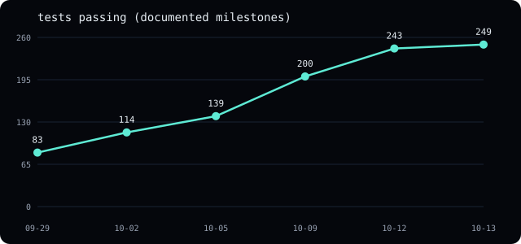
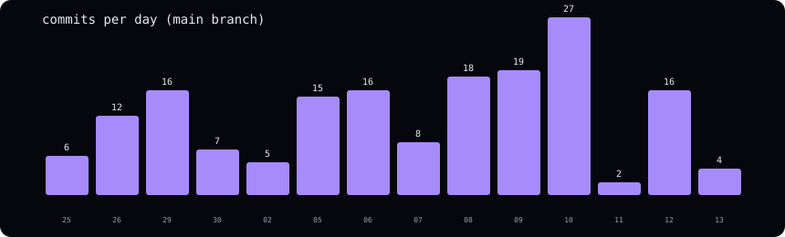
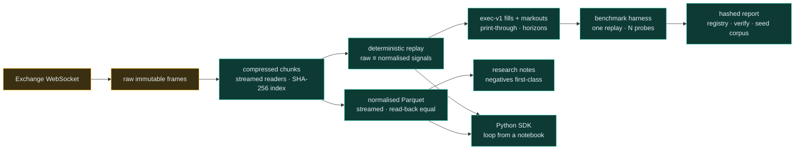
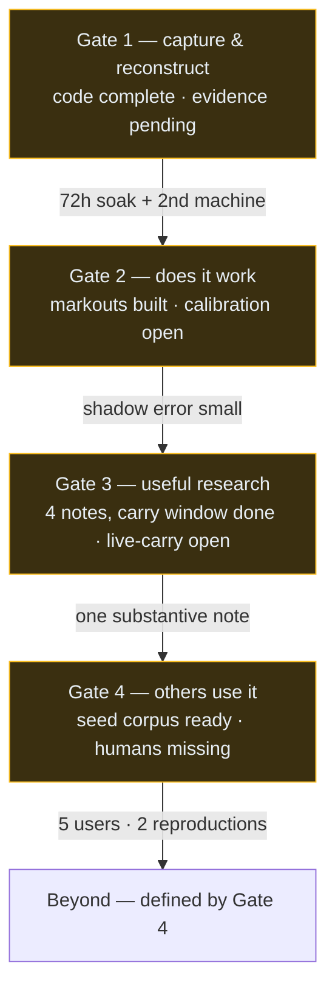

# Project status — 2026-10-12

Where the Astral Project stands, in numbers, diagrams, and gates. Every
figure below is derived from the repository itself (the test suite, file
birth dates, `git log`, the audit follow-ups note); sources are stated per
figure so nothing here relies on memory. Supersedes
`status-2026-10-10.md`, which stays as history.

## Headline numbers

| Metric | Value | Source |
|---|---|---|
| Tests passing | 249, 0 failing | `cargo test --workspace`, 2026-10-13 |
| Clippy / fmt | zero warnings / clean | same run, `-D warnings` |
| Crates | 8 (record, book, types, normalize, replay, exec, harness, python) | workspace members |
| Spec/runbook docs | 10, all built to the site | `docs/` + `website/build.py` |
| Research notes published | 13 (3 negative + carry trilogy + band gradient + full year + sessions + halt positioning + persistence trilogy) | `research/001-*` through `013-*` |
| Commits on main | 171 across 14 active days | `git log` |
| Live venues verified | Binance + Bybit captures, Coinbase trades/tickers | README verification record |
| Open audit findings | 1 of 13 still open (tail holes, documented) | `docs/audit-2026-10-06.md` follow-ups |
| Seed benchmark corpus | 2 reproducing runs out of the box | `benchmark-corpus/` + `verify` verdicts |

## Growth

Test counts come from commit messages that state them (83 on 09-29, 114 on
10-02, 139 on 10-05, 200 on 10-09) plus direct measurements (243 on 10-12,
249 on 10-13, `cargo test --workspace`) — milestones, not continuous
sampling.
The slope is real work, not test inflation: each jump arrived with the
feature it covers (adversarial fixtures, replay events, exec/harness,
streaming ports, markouts, property sweeps, sweep subcommand).

Ten pushes on 10-10 through 10-12 closed every code-actionable audit item:
streaming replay, streaming normalize, normalized replay, streamed
reconstruct/compare, maturin packaging, Python loop bindings, snapshot
guidance, markouts, Fixed properties, the determinism gate, and the seed
corpus — each pushed and verified separately.

## System map

## Gate funnel

Each gate has a kill criterion in `ROADMAP.md` (10 bps model error, 3
fruitless months, 6 userless months). The funnel is honest about what blocks
each step: wall-clock evidence and other humans, both unhurriable by commits.

## Audit closure funnel

13 findings entered; 12 closed: overflow guards, soak backoff, manifest
trust, schema gate, book errors, all CLI formats, trade sides, reconstruct
gaps, sequence breaks, used-dir refusal, gap numbers, fuzz coverage —
plus streaming (replay, normalize, reconstruct, compare, all measured),
behavioral unification (`replay_normalized`: null rows replay as skips,
raw ≡ normalized proven), snapshot guidance without a memory-mapped
format, and the determinism gate. Open: tail holes (finding 9, documented
as correct-by-construction). Post-audit hardening with README rows:
decimal range, corrupt prints/sizes, BookTop gap-breaking, verify path
validation, non-UTF8 skips, fee-error naming, gap-number recovery, seeded
fuzzing, partition-by-instrument, index-count verification,
undecodable-abort coverage, trade price range, failure-policy quiet
corners, Fixed rounding ties, markouts, seed corpus. Full table in the
audit doc.

## What ends the OSS

What closes Gates 1–3 from here: the soak and second-machine evidence
(both need hardware outside this machine), calibration/shadow measurement
(weeks of observation), a substantive research note (needs a data window,
e.g. funding carry once perp streams are reachable), and external users
(need outreach, not code). The code is done to the strategy's definition —
every "code open" item in the progress ledger is now built, measured, and
pinned. What remains is evidence and humans.
